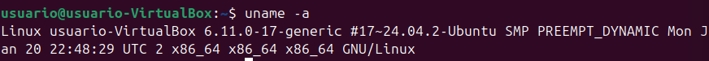
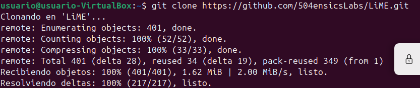
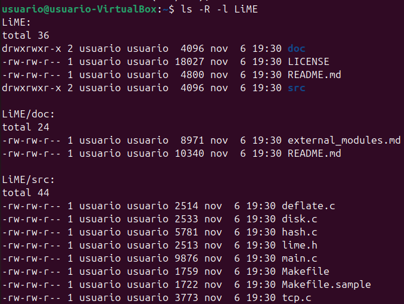
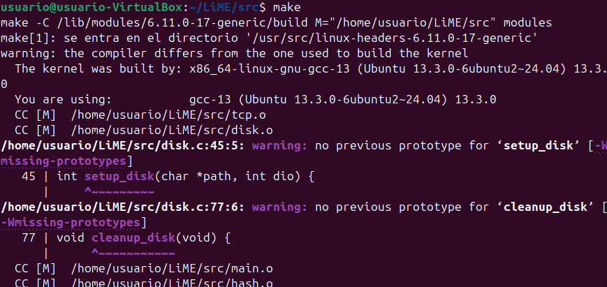
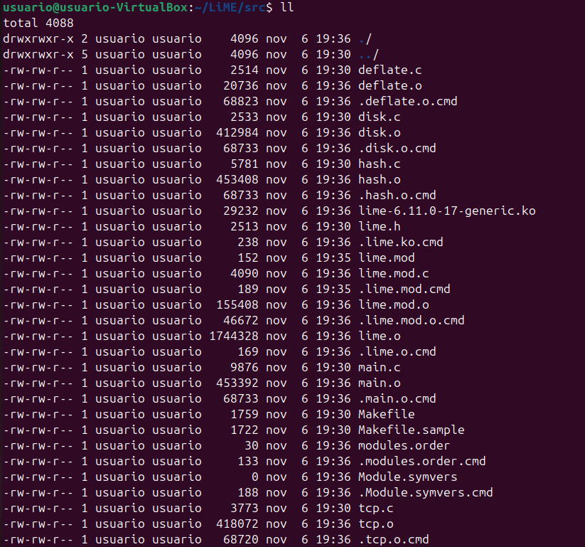
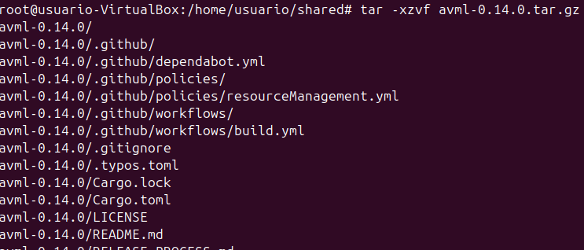
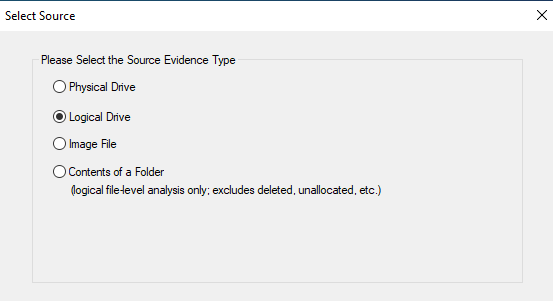
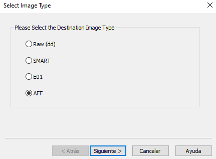
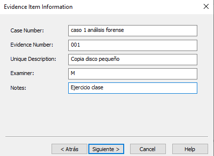
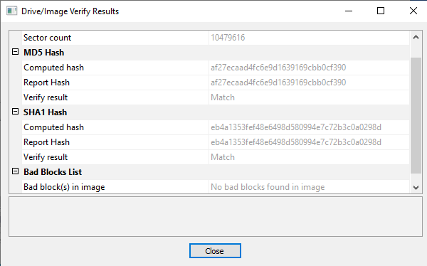

# Forense de memoria: adquisición, cadena de custodia y análisis con Volatility

**Resumen:** documento el ciclo básico de un análisis forense de memoria RAM: registrar la evidencia con cadena de custodia, adquirirla (Windows y Linux), verificar su integridad con hashes y analizar un volcado real de un equipo comprometido. En el análisis con Volatility 2 de un Windows 7 SP1 x64 reconstruí una infección por **Meterpreter** lanzada desde un script VBS, con conexión inversa al atacante, y profundicé con plugins adicionales de examen de memoria de proceso, protección de VAD, servicios/drivers y sistema de ficheros (MFT). Como complemento, incluyo una imagen de disco con FTK Imager verificada por hash.

## Contexto

- **Objetivo:** practicar el tratamiento de evidencia volátil sin alterarla y extraer de la memoria qué ocurrió en un equipo comprometido.
- **Entorno:** Windows (RamCapturer, MRC, FTK Imager), Ubuntu 24.04 en VirtualBox (LiME, AVML) y Kali Linux con Volatility 2 para el análisis.
- **Por qué la RAM primero:** es la evidencia más volátil. Según el orden de volatilidad de la [RFC 3227](https://www.rfc-editor.org/rfc/rfc3227), se captura antes que el disco porque se pierde al apagar el equipo.
- **Entorno de laboratorio:** todo se hizo en máquinas de práctica, con evidencias de ejercicio.

### Qué cubre cada parte

| Fase | Qué hice | Evidencia en este repo |
|---|---|---|
| Inventario y custodia | Registré dos capturas de RAM con hash y responsable | Tabla de la sección 1 |
| Captura de RAM en Windows | Dos capturas con RamCapturer y con MRC | Solo el inventario, sin capturas del proceso |
| Captura de RAM en Linux | **Preparé** LiME y AVML (descarga y compilación) | Capturas de pantalla |
| Análisis de memoria | Análisis con Volatility 2 de un volcado de Windows 7, con plugins adicionales de examen de procesos, protección de memoria y sistema de ficheros | Informe ejecutivo + técnicas adicionales (sección 3) |
| Imagen de disco | Imagen lógica con FTK Imager y verificación | Capturas de pantalla |

## Metodología

1. Registrar cada evidencia en un inventario (ID, custodio, fecha y hora, descripción, tamaño, herramienta y hash).
2. Capturar la memoria con una herramienta de adquisición y calcular su hash.
3. Trabajar siempre sobre una copia y comprobar el hash antes y después del análisis.
4. Analizar el volcado con Volatility 2 y redactar un informe ejecutivo con la secuencia de hechos.

## 1. Cadena de custodia e inventario

Inventario de las dos capturas de RAM:

| ID | Custodia | Fecha y hora | Descripción | Tamaño | Herramienta | Hash |
|---|---|---|---|---|---|---|
| H1 | IHG | 24/10/2025 14:01 | Copia de memoria RAM | 8 912 896 KB (8,5 GiB) | RamCapturer | MD5 calculado con `certutil` (`hash1.txt`) |
| H2 | IHG | 25/10/2025 16:04 | Copia de memoria RAM | 8 912 896 KB (8,5 GiB) | MRC | MD5 calculado con `certutil` (`hash2.txt`) |

- Las dos capturas se hicieron con herramientas distintas y con un día de diferencia, así que sus hashes **deben** ser distintos: la memoria cambia mientras el equipo está encendido.
- El hash sirve para demostrar que cada captura no se ha modificado desde que se adquirió, no para compararlas entre sí.

## 2. Adquisición de memoria

### Windows: RamCapturer y MRC

Hice dos capturas de RAM con herramientas distintas, RamCapturer y MRC, y las registré en el inventario de arriba. Ambos ficheros ocupan lo mismo: 8 912 896 KB (8,5 GiB).

### Linux: preparación de LiME y AVML

Esta parte es de **preparación**: dejé listas las herramientas para capturar la memoria de un Linux, pero en la práctica no llegué a lanzar la captura.

**LiME** es un módulo de kernel (LKM), por lo que hay que compilarlo para el kernel exacto de la máquina. Primero comprobé la versión:



Descargué el repositorio oficial de LiME e inspeccioné su contenido (código fuente en `src/`):





Instalé `make` y `gcc` (ya estaban en su última versión) y compilé desde `src/`. El compilador avisa de prototipos que faltan en `disk.c`, avisos que no impiden la compilación:



Resultado: el módulo `lime-6.11.0-17-generic.ko`, con el kernel de la máquina en el nombre.



Copié la carpeta de LiME a un pendrive para llevarla a la máquina a capturar:


**AVML** (Acquire Volatile Memory for Linux) es la herramienta de Microsoft para capturar memoria en Linux sin compilar un módulo para cada kernel. La descargué en una carpeta compartida de la máquina virtual, porque el pendrive fallaba a veces en la VM, y la descomprimí:



**Cómo se usarían (no ejecutado en la práctica):**

```bash
# LiME: cargar el módulo y volcar la memoria en formato lime
sudo insmod lime-6.11.0-17-generic.ko "path=/ruta/ram.lime format=lime"

# AVML
sudo ./avml /ruta/ram.lime
```

> El fichero que descargué de AVML (`avml-0.14.0.tar.gz`) contiene el código fuente (`Cargo.toml`, `.github`...), así que para usarlo hay que compilarlo con `cargo` o descargar el binario de la release.

## 3. Análisis con Volatility 2: infección por Meterpreter

El análisis se hizo sobre un volcado de memoria de un equipo **Windows 7 SP1 x64** comprometido, con Volatility 2 desde Kali Linux. Verifiqué la integridad del volcado antes y después del análisis con **SHA-1 y SHA-256**, y no cambió en ningún momento.

### Resultado

El sistema tenía una infección activa por un RAT (*Remote Access Trojan*) identificado como **Meterpreter**, y el atacante mantenía acceso remoto en el momento del volcado.

### Secuencia de hechos

```
vhjReUDEuumrX.vbs  (script VBS, ejecutado por el usuario o descarga maliciosa)
        |
wscript.exe  (PID 5116)  -> proceso padre
        |
UWkpjFjDzM.exe  (PID 3496)  -> Meterpreter
        |
conexión inversa a 10[.]0[.]0[.]106:4444
```

1. El atacante consiguió ejecutar un script de Visual Basic en la víctima, probablemente por ingeniería social o una descarga maliciosa.
2. `wscript.exe` (PID 5116) lanzó el ejecutable `UWkpjFjDzM.exe` (PID 3496), que es Meterpreter y abrió una conexión inversa a `10[.]0[.]0[.]106:4444`.
3. Con acceso remoto, el atacante pudo acceder al sistema de ficheros y a la memoria, y según el informe pudo exfiltrar archivos sensibles como `EMPLOY~1.XLS`.
4. La cuenta de **Bob no tenía contraseña**, lo que habría facilitado el movimiento lateral o la escalada de privilegios.

### IOCs

| Tipo | Valor | Qué es |
|---|---|---|
| Script | `vhjReUDEuumrX.vbs` | Script VBS que inicia la infección |
| Proceso | `wscript.exe`, PID 5116 | Intérprete de scripts, proceso padre |
| Proceso | `UWkpjFjDzM.exe`, PID 3496 | Ejecutable de Meterpreter |
| IP y puerto | `10[.]0[.]0[.]106:4444` | Destino de la conexión inversa (atacante) |
| Fichero | `EMPLOY~1.XLS` | Fichero sensible que el informe indica como exfiltrado |
| Cuenta | `Bob` (sin contraseña) | Cuenta débil del equipo |

> Los nombres aleatorios de script y ejecutable y el puerto 4444 son coherentes con un payload generado con Metasploit.

### Clasificación y MITRE ATT&CK (propuesto)

| Táctica | Técnica | Base |
|---|---|---|
| Ejecución | T1204.002 User Execution: Malicious File | Probable, por ingeniería social o descarga |
| Ejecución | T1059.005 Command and Scripting Interpreter: Visual Basic | Script `.vbs` ejecutado con `wscript.exe` |
| Comando y control | T1095 Non-Application Layer Protocol | Conexión inversa a `:4444` (probable) |
| Colección | T1005 Data from Local System | Acceso al sistema de ficheros |
| Exfiltración | T1041 Exfiltration Over C2 Channel | Según el informe, posible exfiltración de `EMPLOY~1.XLS` |

### Técnicas adicionales de análisis

Además del árbol de procesos y la conexión de red, usé varios plugins más de Volatility 2 para profundizar en la evidencia:

- **`vadinfo`** (*Virtual Address Descriptor*): muestra la protección de memoria de cada región de un proceso. Una región con protección `PAGE_EXECUTE_READWRITE` (escribible y ejecutable a la vez) es una señal clásica de inyección de código o shellcode, frente a regiones normales como `PAGE_READONLY` o `PAGE_NOACCESS`.
  ```
  volatility -f 1.-Memory.mem --profile=Win7SP1x64 vadinfo | grep -A 5 "<dirección del nodo VAD>"
  ```
- **`volshell` + `vaddump` + `strings`**: para examinar en detalle un proceso concreto entré en la consola interactiva de `volshell`, localicé su PEB (*Process Environment Block*, con la ruta del ejecutable y punteros a sus estructuras de memoria), volqué sus regiones de memoria a disco con `vaddump` y las inspeccioné con `strings` — la misma técnica que serviría para recuperar texto legible de lo que un proceso tenía en memoria en el momento de la captura.
- **`svcscan` y `devicetree`**: enumeran, respectivamente, los servicios de Windows y la jerarquía de drivers/dispositivos del kernel. Se usan para detectar servicios maliciosos instalados como mecanismo de persistencia o drivers de rootkit que no aparecen en un listado de procesos normal.
- **`mftparser`**: localiza un registro concreto de la MFT (*Master File Table*) del sistema de ficheros NTFS, con sus marcas de tiempo (`$STANDARD_INFORMATION` y `$FILE_NAME`) y su nombre corto en formato 8.3. Lo usé para confirmar, directamente desde el registro de la MFT, el nombre corto del fichero sensible (`EMPLOY~1.XLS`), en vez de depender solo de lo que mostraba el proceso en memoria.
- **`hashdump`**: extrae los hashes NTLM/LM de las cuentas locales del SAM cargado en memoria. El hash de la cuenta de `Bob` correspondía al de una contraseña **vacía** (confirmado al introducirlo en un crackeador de hashes online), lo que confirma que la cuenta no tenía ninguna contraseña establecida, no solo una contraseña débil.

### Limitaciones

- Las técnicas de esta sección están documentadas a nivel de comando y hallazgo, a partir de mis propias notas de prácticas, pero sin captura de pantalla propia para este repo.
- El informe dice que el atacante **pudo** exfiltrar `EMPLOY~1.XLS`. Sin tráfico de red, la memoria por sí sola no confirma que saliera del equipo.

## 4. Complemento: imagen de disco con FTK Imager

Aunque no es memoria, completa el flujo de adquisición. Con FTK Imager 8.2 hice una imagen de una partición NTFS de 5 GB en un disco virtual creado solo para la práctica, porque el disco principal era muy grande.

- Origen: unidad lógica (*Logical Drive*), para copiar la partición.
- Formato: **AFF**, un formato forense.





Antes de crear la imagen, FTK Imager pide los datos de la evidencia (caso, número de evidencia, descripción, examinador), el equivalente digital a la etiqueta de una bolsa de evidencias:



Al terminar, la herramienta verifica la imagen: los hashes **MD5 y SHA-1** calculados coinciden con los del informe (*Match*) y no hay bloques defectuosos.



Además de la imagen, FTK Imager genera un `.txt` con los metadatos de la adquisición.

## Mitigación y recomendaciones

- **Inmediata:** aislar la red del equipo comprometido **sin apagarlo** para no perder la memoria, capturar la RAM primero, bloquear la IP `10[.]0[.]0[.]106` y el puerto de salida 4444 y restablecer las credenciales.
- **Medio plazo:** poner contraseña a todas las cuentas (como la de Bob) con una política de contraseñas, restringir la ejecución de scripts VBS (deshabilitar Windows Script Host o usar AppLocker), buscar el script y el ejecutable por hash en el resto de equipos y desplegar un EDR.
- **Largo plazo:** sustituir Windows 7, sin soporte desde enero de 2020, filtrar el tráfico saliente por puertos y formar a los usuarios contra scripts y adjuntos sospechosos.

## Qué aprendí y qué mejoraría

- La RAM se captura primero y con un registro detallado (quién, cuándo, con qué herramienta, qué hash). Si no está en el inventario, no existe como evidencia.
- LiME exige compilar el módulo para el kernel exacto, mientras que AVML evita ese paso. La práctica fue rápida y sencilla, y el único problema fue el pendrive, que fallaba a veces en la máquina virtual.
- **Mejoras pendientes:**
  - Ejecutar de verdad la captura con LiME y AVML y verificar su hash.
  - Usar **SHA-256** en el inventario de las capturas de RAM en lugar de MD5, que ya no se considera seguro frente a colisiones.
  - Recalcular el hash de H2 con `certutil -hashfile <fichero> SHA256` y repasar el inventario, porque en el original el hash de H2 está incompleto.
  - Añadir capturas propias de los plugins adicionales (`vadinfo`, `volshell`, `svcscan`, `mftparser`, `hashdump`) en vez de documentarlos solo a nivel de comando y hallazgo.

## Fuentes

- [LiME: Linux Memory Extractor](https://github.com/504ensicsLabs/LiME)
- [AVML: Acquire Volatile Memory for Linux](https://github.com/microsoft/avml)
- [Volatility Foundation: Volatility 2](https://github.com/volatilityfoundation/volatility)
- [RFC 3227: Guidelines for Evidence Collection and Archiving](https://www.rfc-editor.org/rfc/rfc3227)
- [MITRE ATT&CK](https://attack.mitre.org/)
