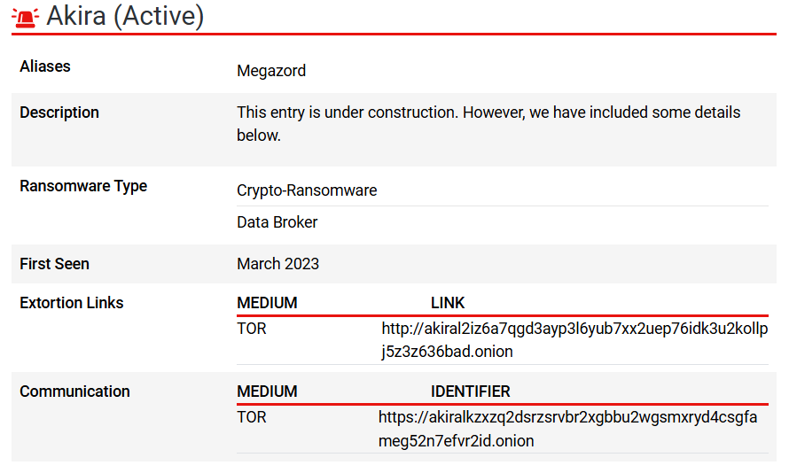
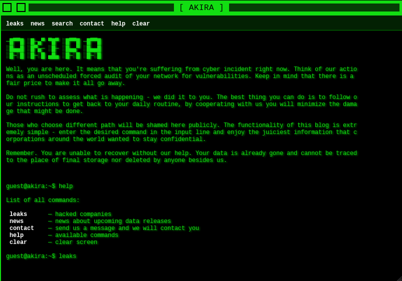
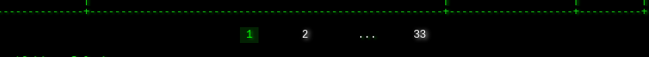
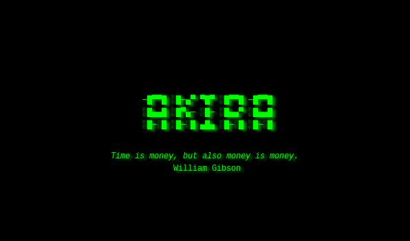

# Investigación de threat intelligence: el grupo de ransomware Akira en Tor

**Resumen:** configuré un entorno de análisis con geolocalización en Wireshark (MaxMind) y Tor, y lo usé para investigar en fuentes abiertas al grupo de ransomware **Akira**: su modelo de negocio (RaaS), sus tácticas y su sitio de extorsión en la red Tor.

## Contexto

- **Objetivo:** practicar OSINT e investigación de amenazas sobre un grupo de ransomware activo, usando fuentes públicas y la propia red Tor como canal de comunicación de los atacantes.
- **Entorno:** Kali Linux, firewall `ufw`, MaxMind GeoLite2 + Wireshark, navegador Tor, ProtonVPN.
- **Por qué este montaje:** antes de navegar por Tor conviene reducir la superficie expuesta: firewall restrictivo con registro de eventos, salida de tráfico solo por las interfaces de la VPN y el propio Tor, y una VPN como capa adicional.

## Metodología

1. Configurar `ufw` en modo restrictivo (denegar por defecto entrada y salida) y permitir solo el tráfico de las interfaces de ProtonVPN y Tor, con logging activado.
2. Instalar las bases de datos GeoLite2 de MaxMind en Wireshark para poder geolocalizar IPs en capturas de tráfico.
3. Instalar el navegador Tor y ProtonVPN como capas de anonimato para la investigación.
4. Buscar en fuentes de threat intelligence (WatchGuard Threat Lab y similares) el perfil del grupo y sus enlaces `.onion` activos.
5. Acceder únicamente a la terminal pública de Akira para documentar su funcionamiento, sin descargar ni distribuir ningún dato.

## Perfil del grupo: Akira

- **Tipo:** ransomware como servicio (RaaS) con doble extorsión: cifra los datos y, además, los roba y amenaza con publicarlos.
- **Víctimas:** organizaciones de sanidad, educación, finanzas, manufactura e infraestructuras críticas en Norteamérica, Europa y Asia.
- **Acceso inicial y movimiento:** suele explotar servicios expuestos o campañas de phishing, y una vez dentro usa herramientas legítimas (PowerShell, SSH) para moverse lateralmente, escalar privilegios y desactivar defensas — vive de la tierra (*living off the land*) más que de malware a medida.
- **Exfiltración:** antes de cifrar, saca grandes volúmenes de datos con herramientas legítimas de transferencia (WinSCP, FileZilla, Rclone) hacia servidores propios.
- **Alcance técnico:** tiene variantes para Linux y para entornos VMware, lo que le permite atacar infraestructuras de virtualización completas.
- **Vínculos con otros grupos:** el análisis de direcciones Bitcoin muestra reutilización de carteras entre operadores de **Conti** (activo 2020–2022) y Akira, lo que sugiere que parte de sus afiliados migraron tras la desaparición de Conti. También se observan similitudes de técnica con Hive, BlackCat y LockBit, sin que conste una conexión directa.

Según esa fuente, Akira se detectó por primera vez en marzo de 2023 y sigue activo. Clasifica sus enlaces `.onion` en dos tipos: de **extorsión** (donde publica los datos robados) y de **comunicación** (donde negocia con las víctimas).

## El sitio de Akira en Tor

El sitio de extorsión es una terminal de texto estilo años 80 con cinco comandos: `help`, `leaks`, `contact`, `news` y `clear`.

- **`leaks`:** lista las organizaciones atacadas, con una breve descripción de cada una y un enlace para acceder a una muestra de los datos robados (incluye un enlace magnet para clientes de torrent). En el momento de la práctica había **33 páginas** de víctimas, unas 8 por página: una idea del volumen de ataques de este grupo.
- **`contact`:** abre un formulario para que la víctima negocie el rescate.
- **`news`:** anuncios del grupo (plazos, amenazas de publicación, novedades).

> No descargué ni accedí a ningún dato de las víctimas listadas en `leaks`, ni usé el comando `contact`: la investigación se queda en documentar cómo funciona el sitio, no en interactuar con datos robados ni con los atacantes.

El segundo enlace `.onion` relacionado con el grupo solo muestra una cita de William Gibson ("Time is money, but also money is money"), que resume bien su lógica de presión: cuanto más tiempo pasa sin pagar, peor para la víctima.

El resto de enlaces `.onion` encontrados en otras fuentes (WatchGuard, RansomLook, MITRE ATT&CK) estaban deshabilitados en el momento de la práctica.

## Clasificación (MITRE ATT&CK, grupo)

| Táctica | Técnica típica de Akira |
|---|---|
| Acceso inicial | T1190 Exploit Public-Facing Application / T1566 Phishing |
| Ejecución | T1059.001 PowerShell |
| Movimiento lateral | T1021.004 Remote Services: SSH |
| Exfiltración | T1567 Exfiltration Over Web Service (herramientas como Rclone) |
| Impacto | T1486 Data Encrypted for Impact |

## Mitigación y recomendaciones

- **Prevención:** exponer el mínimo de servicios a internet, parchear rápido las vulnerabilidades conocidas y formar contra el phishing, que son sus vías de entrada más comunes.
- **Detección:** vigilar el uso anómalo de PowerShell y SSH para movimiento lateral, y el tráfico saliente hacia herramientas de transferencia masiva (Rclone, WinSCP) fuera de horario.
- **Respuesta:** tener copias de seguridad offline e inmutables, porque con doble extorsión pagar el rescate no garantiza que los datos robados no se publiquen igualmente.
- **Inteligencia:** monitorizar fuentes de threat intel (feeds de ransomware, MITRE ATT&CK) para detectar pronto si la organización aparece listada como víctima.

## Qué aprendí y qué mejoraría

- Investigar en Tor sin exponerse exige preparación previa: firewall restrictivo, VPN y no interactuar más allá de lo necesario para documentar.
- Me quedé con ganas de investigar más grupos y de contrastar más fuentes, pero el tiempo de la práctica fue limitado.
- **Mejora pendiente:** ampliar la investigación a otros grupos de ransomware activos y comparar sus modelos de negocio y técnicas.

## Fuentes

- WatchGuard Threat Lab (ficha del grupo Akira)
- [MaxMind Database Paths en Wireshark](https://www.geeksforgeeks.org/ethical-hacking/maxmind-database-paths-in-wireshark/)
- [Vectra AI: Akira](https://es.vectra.ai/modern-attack/threat-actors/akira)
- [Ransomware Help: Akira](https://www.ransomwarehelp.com/es/tipos-de-ransomware/ransomware-akira/)
- [cybersecuritynews.es: Akira y Microsoft 365](https://cybersecuritynews.es/el-ransomware-akira-y-los-ataques-a-microsoft-365-entre-las-principales-amenazas/)
