# Escaneo de vulnerabilidades con Nuclei y automatización con n8n

**Resumen:** escaneé una máquina Metasploitable con **Nuclei**, primero con sus plantillas por defecto y después con una plantilla propia para detectar un phpMyAdmin con acceso sin contraseña. Después monté un flujo en **n8n** para convertir el resultado del escaneo (JSON) en un informe en HTML de forma automática. El último paso (entregar el informe como fichero) no llegué a completarlo.

## Contexto

- **Objetivo:** practicar el escaneo automatizado de vulnerabilidades y la integración de su salida en una herramienta de automatización (SOAR a pequeña escala).
- **Entorno:** Kali Linux, Nuclei (Go), Metasploitable como máquina objetivo, n8n en Docker.
- **Por qué Nuclei + n8n:** Nuclei detecta el problema; n8n automatiza qué hacer con el resultado, un patrón habitual en SOC para convertir hallazgos de un escáner en alertas o informes legibles.

## Metodología

1. Instalar Nuclei y comprobar su funcionamiento con las plantillas oficiales de la comunidad contra Metasploitable.
2. Buscar vulnerabilidades con CVE conocido en la máquina objetivo.
3. Escribir una plantilla propia para detectar un problema concreto: acceso sin contraseña al panel de administración phpMyAdmin.
4. Montar un flujo en n8n que lea el resultado de Nuclei (JSON), lo limpie y lo convierta en un informe HTML.

## Escaneo con Nuclei

Comprobación de la instalación:

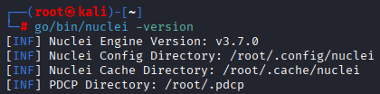

Primer escaneo con las plantillas por defecto de la comunidad (se instalan solas la primera vez) contra Metasploitable. Entre los hallazgos, Nuclei marca en severidad **crítica** una vulnerabilidad con CVE conocido (`CVE-2012-1823`, ejecución remota de PHP) expuesta en el objetivo:

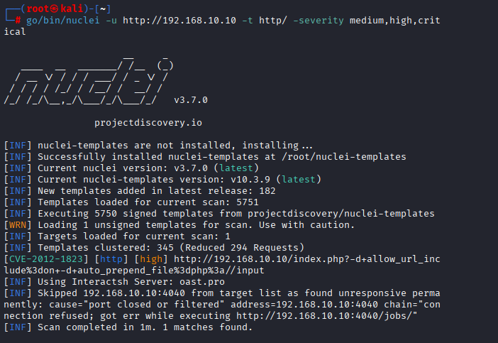

### Plantilla propia: phpMyAdmin sin contraseña

Las plantillas de Nuclei se escriben en YAML. Escribí una plantilla que intenta iniciar sesión en el phpMyAdmin del objetivo con el usuario `root` y contraseña vacía, y la marca como hallazgo si lo consigue:

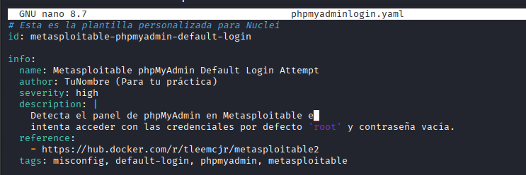

Al lanzarla contra la máquina objetivo, Nuclei confirma el acceso sin contraseña y guarda el resultado en un fichero JSON:

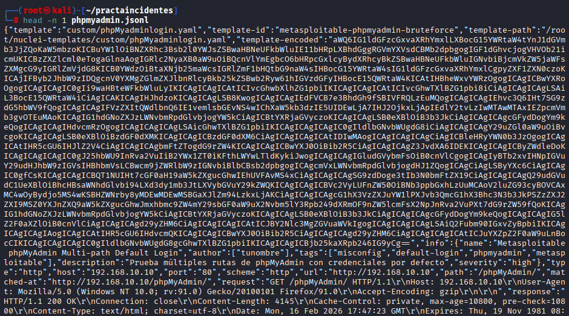

## Automatización con n8n

Desplegué n8n en Docker y creé la cuenta de administración:

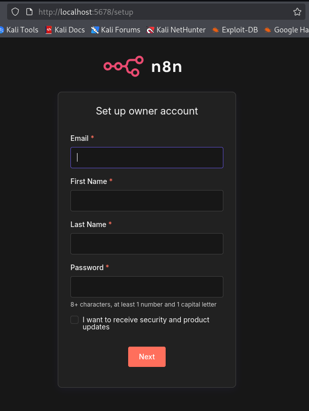

El flujo que monté, nodo a nodo:

| Nodo | Función |
|---|---|
| Read/Write Files from Disk | Lee del disco el fichero JSON que generó Nuclei |
| Extract from File | Convierte el binario leído en JSON |
| Code (JavaScript) | Limpia y reordena el JSON para que sea legible |
| HTML | Genera un informe en HTML a partir del JSON ordenado |
| Convert to File | Convierte el HTML (texto) en un fichero descargable |
| Read/Write Files from Disk | *(objetivo: guardar el HTML como fichero en el equipo — no funcionó)* |

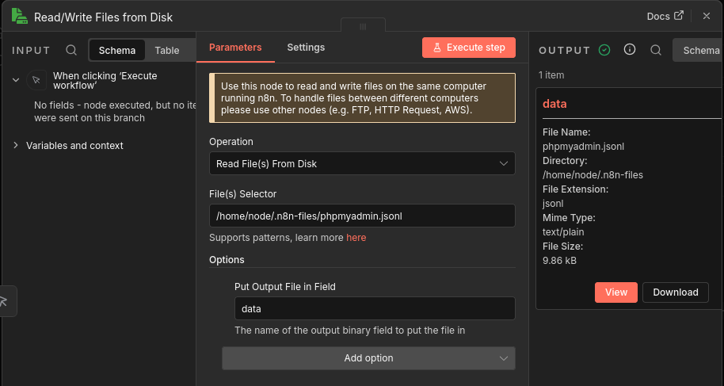

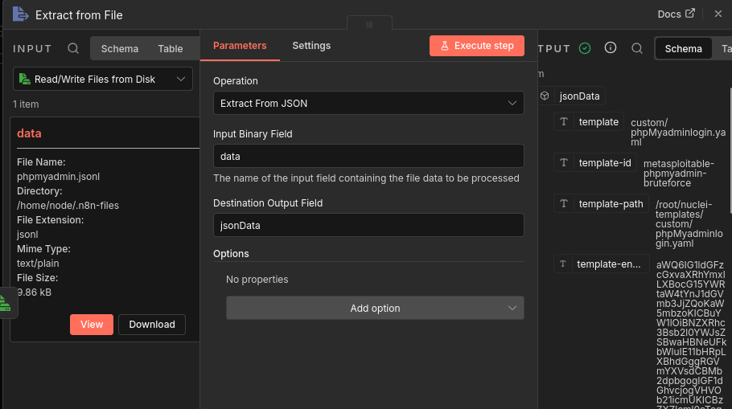

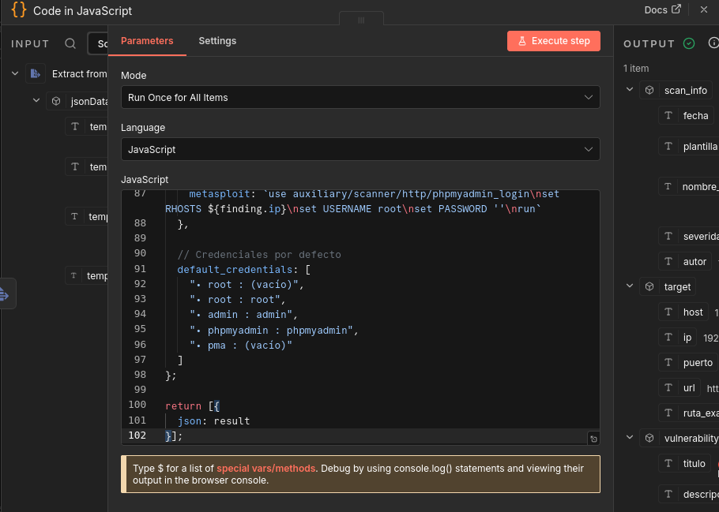

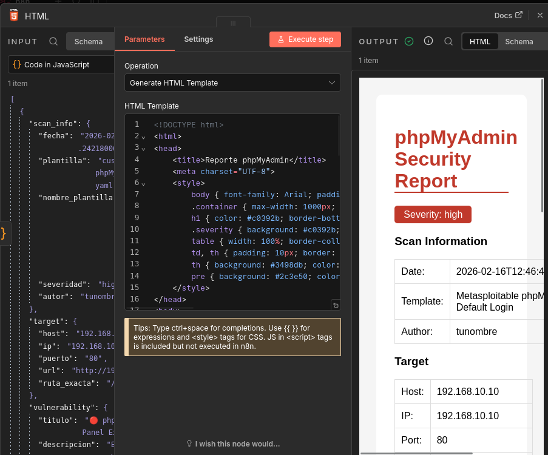

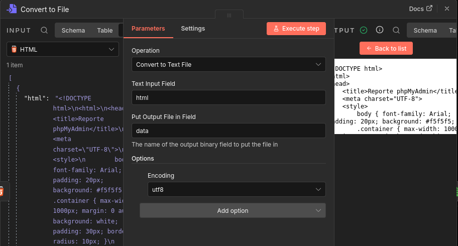

Flujo completo:

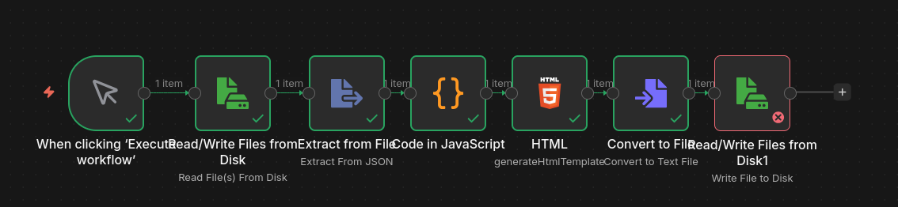

**Limitación:** el último nodo (guardar el HTML generado como fichero en el equipo) no llegó a funcionar pese a probar varias configuraciones. El informe se genera correctamente dentro del flujo, pero no se exporta a disco. Como alternativa no probada, podría haberse enviado por correo con un nodo de email en vez de a disco.

## Identificación del incidente (hallazgo principal)

- **Qué:** panel de administración phpMyAdmin expuesto en el puerto 80, con el usuario `root` sin contraseña.
- **Impacto:** acceso completo a la base de datos, con posibilidad de leer, modificar o borrar datos, provocar una denegación de servicio o usarlo como punto de partida para escalar privilegios en el sistema.

## Mitigación

- Establecer una contraseña robusta para el usuario `root` de la base de datos.
- No exponer phpMyAdmin en el puerto por defecto; si debe estar accesible, moverlo a un puerto no estándar.
- Restringir el acceso por IP de origen desde el servidor web (Apache) o con reglas de firewall.

## Qué aprendí y qué mejoraría

- Nuclei es muy rápido para validar hallazgos conocidos (CVE) y también para detectar configuraciones inseguras propias con una plantilla a medida.
- n8n resultó más intuitivo de lo que esperaba para encadenar los datos de un escáner hasta un informe legible.
- **Mejora pendiente:** terminar el nodo de exportación a disco (o sustituirlo por un envío por correo o un webhook) para que el informe llegue a alguna parte de forma automática.

## Fuentes

- [Nuclei](https://github.com/projectdiscovery/nuclei)
- [Nuclei templates](https://github.com/projectdiscovery/nuclei-templates)
- Documento guiado proporcionado por el profesor
