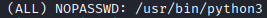
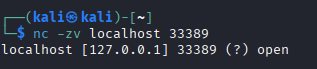
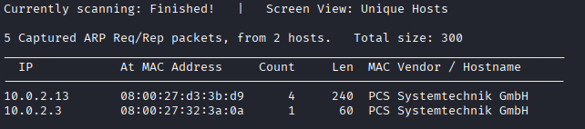
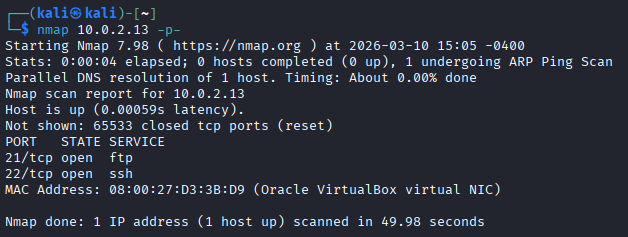
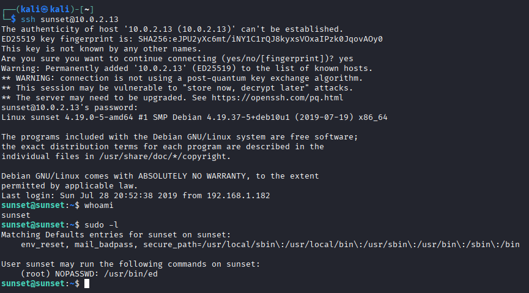

# Post-explotación: acceso, escalada, persistencia y pivoting (laboratorio)

**Resumen:** en tres ejercicios de laboratorio practiqué el ciclo completo de post-explotación sobre máquinas Linux y Windows propias y aisladas: obtener acceso inicial, escalar privilegios, instalar varios mecanismos de persistencia, moverme lateralmente a otra máquina de la red y, finalmente, revertir todos los cambios. Documento aquí qué hice y por qué, mapeado a MITRE ATT&CK, sin incluir los comandos ni los scripts exactos: son herramientas de intrusión y lo relevante para un portfolio de blue team es entender el ataque para poder detectarlo y revertirlo, no dejar una receta de ataque lista para copiar y pegar.

## Contexto

- **Objetivo:** entender, desde el lado ofensivo, qué hace un atacante después de entrar en un sistema, para poder detectarlo y revertirlo desde el lado defensivo.
- **Entorno:** máquinas virtuales propias y aisladas (Kali como atacante; Ubuntu y Windows como víctimas), sin conexión a redes reales. Los tres ejercicios comparten módulo (Hacking Ético) y unidad (UT4 – Post-explotación).
- **Por qué sin comandos:** los pasos exactos de persistencia y de shells inversas son, literalmente, código de intrusión. Lo documento a nivel de técnica (qué se hizo y cómo se detecta/revierte), no como procedimiento reproducible.
- **Sobre las capturas:** incluyo solo las que muestran reconocimiento (quién soy, qué hay en la red) y evidencia de la vulnerabilidad explotada (una mala configuración de `sudo`), que es justo lo que un blue teamer revisaría. No hay capturas de los comandos de persistencia, shells inversas ni exfiltración.

## Resumen de los tres ejercicios

| Ejercicio | Víctima | Acceso inicial | Punto fuerte |
|---|---|---|---|
| A. Linux (Ubuntu) | Ubuntu Server | Credenciales débiles por SSH | Pivoting hacia una máquina Windows interna |
| B. Linux (Ubuntu, variante) | Ubuntu Server | Credenciales obtenidas cifrando un fichero capturado con fuerza bruta, tras aprovechar un servicio FTP mal asegurado | Escalada por una shell con permisos sudo mal configurados; antiforénsica |
| C. Windows | Windows (vía acceso remoto ya autorizado en el laboratorio) | — | Reflexión OPSEC: qué queda registrado aunque se intente ocultar la actividad |

## A. Linux: acceso, persistencia y pivoting a una red interna

Arquitectura del ejercicio: Kali como atacante, un Ubuntu comprometido con una pata en una segunda red interna, y un Windows como objetivo final de ese segundo salto.

**Acceso inicial.** Entré por SSH a la máquina Ubuntu con una contraseña débil adivinada por fuerza bruta.

**Escalada de privilegios.** Tras una enumeración básica (usuario, grupos, versión del kernel):

comprobé los permisos de `sudo` del usuario y encontré que podía ejecutar el intérprete de Python como root sin contraseña — una mala configuración habitual en `sudoers` que permite escapar a una shell de root a través del propio intérprete:

**Persistencia (cuatro mecanismos distintos, a propósito, para comparar cómo se detecta y revierte cada uno):**

| Mecanismo | Idea | Cómo se detecta | Cómo se revierte |
|---|---|---|---|
| Clave SSH añadida a `authorized_keys` | Acceso sin contraseña aunque esta cambie | Revisar `authorized_keys` de cada usuario y los logs de SSH | Eliminar la clave del fichero, reiniciar el servicio |
| Usuario adicional con UID de sistema (< 1000) | Cuenta "discreta" que pasa desapercibida entre las de servicio | Revisar `/etc/passwd` y los grupos privilegiados | Eliminar el usuario y su directorio home |
| Tarea en `cron` con nombre camuflado | Reejecuta el acceso aunque se elimine | Revisar `crontab` de todos los usuarios y `cron.d` | Eliminar la tarea y el script asociado |
| Modificación de `.bashrc` | Reabre una conexión cada vez que se abre una terminal | Revisar los ficheros de inicio de shell (`.bashrc`, `.profile`) | Eliminar el contenido añadido y recargar la configuración |

**Reconocimiento interno y pivoting.** Desde la máquina ya comprometida, descubrí que tenía una segunda interfaz de red hacia un segmento interno (`192.168.20.0/24`) y, en él, una máquina Windows con el puerto de escritorio remoto (RDP, 3389) accesible:

Monté un túnel SSH para alcanzar ese puerto desde mi propia máquina atacante, sin tener conexión directa a esa red: el clásico caso en que un solo equipo mal segmentado expone toda una red interna. Comprobación de que el túnel estaba activo y el puerto remoto llegaba hasta mi equipo:

**Evidencia revisada.** Los logs de autenticación del sistema (`/var/log/auth.log` o equivalente) registraron cada fase: los intentos de fuerza bruta, el uso de `sudo` y la actividad de `cron`. Con monitorización activa, este ataque habría dejado rastro desde el primer minuto.

## B. Linux: acceso vía FTP, shell restringida y antiforénsica básica

Variante del mismo ejercicio con un camino de entrada distinto: primero localicé los servicios expuestos:

Aproveché el servicio FTP mal asegurado para obtener un fichero con un hash de contraseña, lo rompí con un ataque de diccionario y usé esa credencial para entrar por SSH. Dentro, la cuenta solo tenía acceso a una shell restringida, pero la enumeración con `sudo -l` reveló que esa shell podía invocarse a sí misma con privilegios elevados:

lo que di como vía para escapar a una shell completa de root — un recordatorio de que restringir el *shell* de login no sirve de nada si el binario permitido puede, a su vez, abrir otro.

Repetí la creación de una cuenta discreta (UID de sistema, sin contraseña, en un grupo con privilegios) y añadí persistencia con clave SSH y una tarea de cron, cuidando además señales secundarias como las fechas de modificación de los ficheros tocados y el historial de la shell — es decir, practiqué también el lado de **ocultar** las huellas, para entender mejor qué debe vigilar un defensor además de los mecanismos de persistencia en sí.

**Lo que esto enseña de cara a detección:** las fechas de modificación de ficheros del sistema y el historial de comandos son señales manipulables, así que no deben ser la única fuente de verdad; los logs centralizados (enviados a un servidor aparte, no solo guardados en la propia máquina) son mucho más fiables porque un atacante con acceso local no puede alterarlos retroactivamente.

## C. Windows: post-explotación y reflexión OPSEC

En un entorno Windows ya accesible para la práctica, el objetivo era menos técnico y más analítico: entender qué evidencia queda en el sistema después de una intrusión y por qué un atacante cuidadoso con las formas (OPSEC) igualmente deja rastro.

**Conclusión principal del ejercicio (y la parte con más valor para un SOC):**

- Los comandos ejecutados por PowerShell quedan registrados en los registros de **PowerShell Operational** y **Script Block Logging**, incluso si el atacante usa `-ExecutionPolicy Bypass` para saltarse restricciones de ejecución: el log sigue viendo el contenido del script.
- `-WindowStyle Hidden` oculta la ventana, no el evento: sigue generando entradas en los registros de Windows.
- Una tarea programada creada para persistencia queda registrada en el **Programador de tareas** y en el **Visor de eventos**, visible para cualquier administrador que revise el sistema.
- En un pentest profesional **no se deben borrar los logs**: hacerlo puede disparar alarmas de seguridad (hay sistemas que monitorizan precisamente la limpieza de logs), destruye la evidencia que el cliente necesita para entender el alcance real del incidente, y compromete la integridad de cualquier investigación forense posterior. El objetivo de un pentest es demostrar impacto, no borrar pruebas.
- Al terminar, se revirtieron los cambios: se eliminaron la persistencia instalada, la cuenta creada y los ficheros temporales generados durante la prueba, y se cerraron las conexiones abiertas.

## Clasificación (MITRE ATT&CK, conjunto de los tres ejercicios)

| Táctica | Técnica |
|---|---|
| Acceso inicial | T1078 Valid Accounts (credenciales débiles / obtenidas por fuerza bruta) |
| Ejecución | T1059.001/.004 Command and Scripting Interpreter (PowerShell / shell Unix) |
| Escalada de privilegios | T1548.003 Sudo and Sudo Caching (mala configuración de `sudoers`) |
| Persistencia | T1098.004 SSH Authorized Keys · T1136.001 Local Account · T1053.003 Scheduled Task/Job: Cron · T1546.004 Unix Shell Configuration Modification |
| Descubrimiento | T1087 Account Discovery · T1082 System Information Discovery · T1046 Network Service Scanning |
| Movimiento lateral / Pivoting | T1572 Protocol Tunneling (túnel SSH) |
| Defense Evasion | T1070 Indicator Removal (antiforénsica básica: fechas de ficheros, historial) |

## Mitigación (aplicable a los tres ejercicios)

- **Acceso inicial:** políticas de contraseñas robustas, MFA en accesos remotos, bloqueo tras intentos fallidos (Fail2ban o similar) y autenticación solo por clave en SSH.
- **Escalada de privilegios:** principio de mínimo privilegio en `sudoers` — nunca `NOPASSWD` sobre intérpretes de comandos — y auditoría periódica de esos permisos.
- **Persistencia:** monitorización de `crontab`, de la creación de cuentas y de cambios en ficheros de configuración de shell; alertas (auditd, SIEM) ante nuevas cuentas o tareas programadas.
- **Segmentación:** la máquina comprometida en el ejercicio A no debería haber tenido visibilidad de la red interna donde estaba el Windows: separar redes por función y filtrar el tráfico entre ellas habría cortado el pivoting.
- **Registro:** centralizar logs fuera del alcance del atacante (un SIEM o un servidor de logs aparte) para que la antiforénsica local no sirva de nada.

## Qué aprendí

- La escalada de privilegios casi nunca depende de una vulnerabilidad "de libro": en los tres ejercicios vino de una mala configuración (sudoers, un servicio expuesto, una shell que se podía invocar a sí misma con más privilegios).
- Practicar varios mecanismos de persistencia a la vez ayuda a entender que ninguno es "el" indicador: hay que vigilar varias superficies (claves SSH, cuentas, cron, ficheros de inicio) porque un atacante suele dejar más de una puerta abierta.
- La parte de Windows fue la que más cambió mi forma de pensar: ocultar una ventana o usar flags de *bypass* no es lo mismo que no dejar rastro. Los logs correctos siguen viendo lo que pasó.
- **Pendiente:** en el ejercicio A no llegué a completar el túnel SSH del todo documentado; sería la siguiente mejora natural, junto con centralizar los logs de las tres máquinas en un único punto para practicar la detección, no solo el ataque.

## Fuentes

- [MITRE ATT&CK](https://attack.mitre.org/)
- Documentación de clase del módulo de Hacking Ético (CETI)
