# Análisis de una infección por Trickbot con Suricata y Wireshark

**Resumen:** analicé una captura de tráfico real de una infección por el troyano Trickbot (julio de 2018). Con Suricata detecté las alertas y extraje los IOCs, y con Wireshark confirmé cada fase del ataque: descarga del malware, envío de información robada al servidor de mando y control, e intento de propagación a otro equipo de la red por SMB.

## Contexto

- **Origen del pcap:** ejercicio `2018-07-02 - Trickbot infection` de [Malware-Traffic-Analysis.net](https://www.malware-traffic-analysis.net/). La página incluye también el correo de malspam y un documento Word con macro, lo que apunta a que la infección empezó con un correo de phishing. El pcap solo contiene el tráfico de red posterior.
- **Objetivo:** reconstruir qué hizo el malware, cuándo y contra quién, y proponer medidas de contención.
- **Entorno:** Kali Linux, Suricata (con reglas Emerging Threats), `jq` y Wireshark.

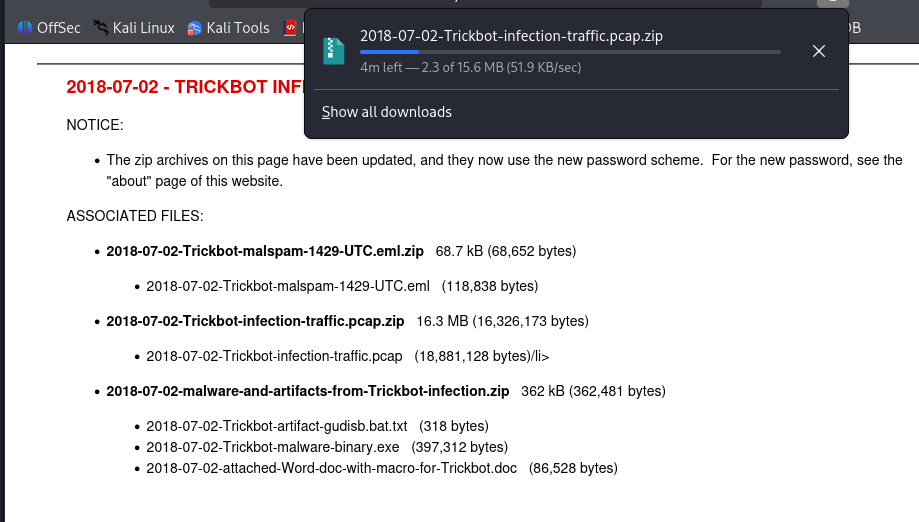

## Metodología

1. Descomprimí el pcap y lo procesé con Suricata en modo offline: `sudo suricata -r <fichero>.pcap`.
2. Suricata generó `eve.json`, con las alertas y los metadatos de cada flujo. Lo consulté con `jq` para extraer IOCs.
3. Con las IPs y horas de las alertas, filtré en Wireshark para ver los paquetes concretos de cada fase.

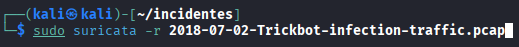

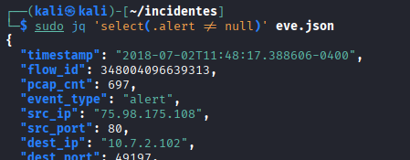

## Resultados

### Alertas por firma

Suricata generó alertas de dos tipos: las de **Trickbot** (descarga, check-in y exfiltración) y las de **SMB mal formado**.

```
12  SURICATA SMB malformed response data
12  SURICATA SMB malformed request data
 5  ET MALWARE Trickbot Checkin Response
 5  ET INFO PE EXE or DLL Windows file download HTTP
 4  ET HUNTING SUSPICIOUS Dotted Quad Host MZ Response
 3  ET INFO Executable Retrieved With Minimal HTTP Headers - Potential Second Stage Download
 2  ET USER_AGENTS Suspicious User-Agent (contains loader)
 2  ET MALWARE Win32/Trickbot Data Exfiltration M2
 1  ET MALWARE Win32/Trickbot Data Exfiltration
 1  ET MALWARE W32/Trickbot C2 (networkDll module)
```

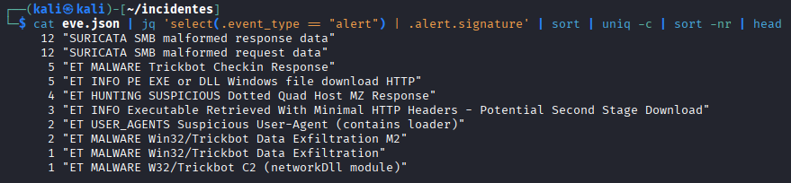

### IOCs

Direcciones y dominios "defanged" (con `[.]`) para que no se abran por error.

| Tipo | Valor | Qué es |
|---|---|---|
| IP víctima | `10[.]7[.]2[.]102` | Equipo infectado |
| IP interna | `10[.]7[.]2[.]8` | Servidor DNS y probable controlador de dominio; destino del tráfico SMB anómalo |
| IP de descarga | `75[.]98[.]175[.]108` | Servidor web que entrega el ejecutable |
| Dominio de descarga | `25kstartups[.]com` | Dominio asociado a esa IP |
| IP de C2 | `188[.]124[.]167[.]132` (puerto 8082) | Servidor de mando y control de Trickbot |
| Dominio de comprobación de IP | `ipecho[.]net` | Servicio de consulta de IP pública; la víctima lo consulta tras la infección |
| Ficheros solicitados | `/sec.bin`, `/toler.png`, `/worming.png`, `/table.png` | Ejecutable y descargas que no son imágenes |

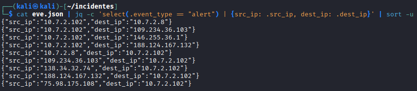

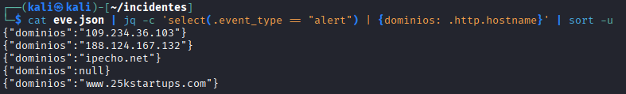

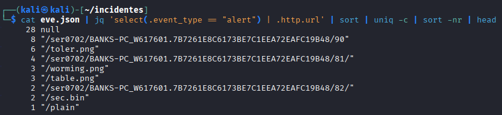

> Los ficheros `.png` descargados no son imágenes: es un patrón habitual de Trickbot para camuflar sus módulos. El nombre `worming.png` sugiere el módulo de propagación, coherente con el intento de movimiento lateral que se ve después.

## Línea temporal

Las horas son las de `eve.json` (zona horaria UTC-4).

| Hora | Fase | Evidencia |
|---|---|---|
| 11:48:17 | Descarga del ejecutable | Alertas *Executable Retrieved With Minimal HTTP Headers* y *PE EXE or DLL Windows file download* desde `75[.]98[.]175[.]108` |
| 11:48:36 | Consulta de IP pública | Alerta *External IP Lookup Domain in DNS Lookup (ipecho .net)* |
| 11:49:58 | Exfiltración | POST a `188[.]124[.]167[.]132` con lista de procesos y salida de `ipconfig`, `net config` y `net view` en el cuerpo |
| 11:52:16 | Movimiento lateral | Tráfico SMB con errores hacia `10[.]7[.]2[.]8` |

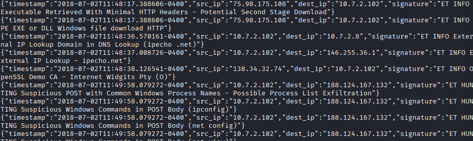

## Análisis por fases

### 1. Descarga del malware (11:48:17)

La víctima hace una petición `GET /sec.bin` al host `25kstartups[.]com` (primero una redirección 301 y después una respuesta `200 OK`). La cabecera `Content-Type: application/octet-stream` y el tamaño de la respuesta (397 312 bytes) indican que se descarga un binario, no una página web.

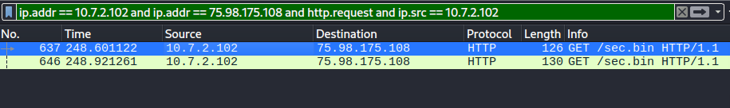

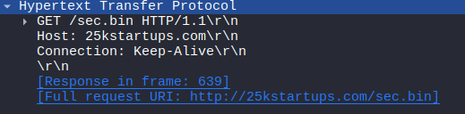

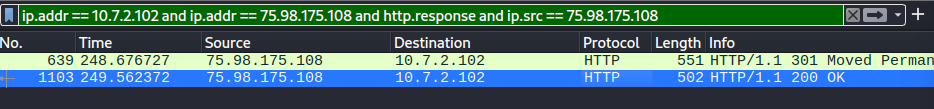

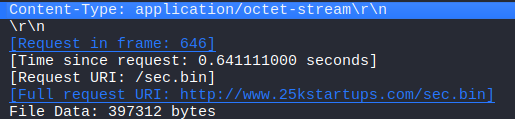

### 2. Exfiltración y comunicación con el C2 (11:49:58)

El equipo infectado envía varias peticiones `POST` al servidor `188[.]124[.]167[.]132:8082`. La URL contiene el nombre del equipo y un identificador, y Suricata la clasifica como *Trickbot Data Exfiltration* y *Checkin*. Las firmas *Suspicious Windows Commands in POST Body* indican que el cuerpo incluye información del sistema y de la red recopilada con comandos como `ipconfig` y `net config`.

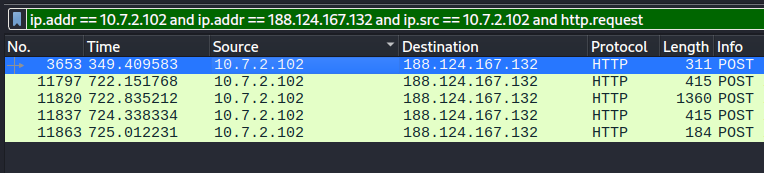

### 3. Intento de movimiento lateral (11:52:16)

Se observa tráfico SMB entre la víctima y `10[.]7[.]2[.]8` con numerosos errores (`Error: TID invalid`, `NT RENAME`...) y las 24 alertas de SMB mal formado de Suricata. Es coherente con un intento de explotación de SMB, como EternalBlue, que es la técnica que usa el módulo de propagación de Trickbot.

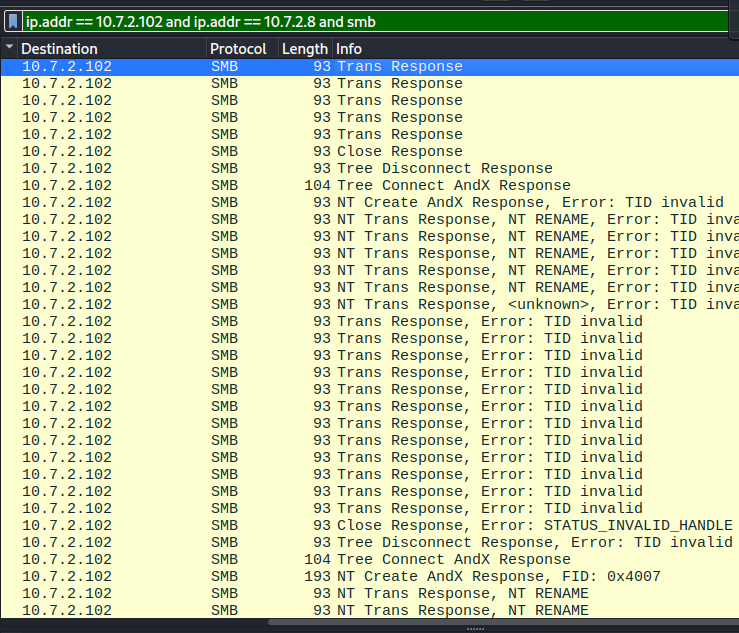

**Limitación:** Suricata no etiqueta este tráfico como EternalBlue, solo como SMB mal formado. Con el pcap no puedo confirmar que el exploit funcionara ni identificar el payload. Lo trato como un **intento de explotación probable**. Para confirmarlo habría que inspeccionar los paquetes SMB (peticiones `Trans2` con tamaños anómalos y shellcode) o contrastar con reglas específicas de EternalBlue.

## Clasificación

Infección por **Trickbot** (troyano bancario y cargador de malware) con un intento de movimiento lateral. El vector de entrada más probable es el **phishing**, según el malspam y el documento con macro asociados al ejercicio.

**Mapeo a MITRE ATT&CK** (propuesto):

| Táctica | Técnica |
|---|---|
| Acceso inicial | T1566 Phishing (probable) |
| Ejecución / Comando y control | T1105 Ingress Tool Transfer, T1071.001 Web Protocols |
| Descubrimiento | T1082 System Information Discovery, T1016 System Network Configuration Discovery |
| Exfiltración | T1041 Exfiltration Over C2 Channel |
| Movimiento lateral | T1210 Exploitation of Remote Services |

## Mitigación

- **Inmediata:** aislar el equipo infectado (desconectarlo o bloquear su tráfico en el firewall), restablecer las credenciales de las cuentas usadas en él y reinstalar el sistema, porque Trickbot es persistente.
- **Medio plazo:** hacer un análisis forense para saber qué datos se filtraron, aplicar el parche **MS17-010** (EternalBlue) en toda la organización y buscar en los logs otros equipos que hayan contactado con las IPs y dominios de los IOCs.
- **Largo plazo:** gestión de parches y vulnerabilidades, segmentación de red (bloquear SMB entre estaciones de trabajo), filtrado de correo y web, y monitorización con reglas de detección como las que han saltado aquí.

## Qué aprendí y qué mejoraría

- Suricata sirve para localizar rápido lo importante, y Wireshark para confirmar los detalles. Combinar `jq` y filtros de Wireshark por IP me ahorró mucho tiempo.
- La parte más difícil fue decidir qué mirar en Wireshark, y entender que una alerta no equivale a una conclusión: el caso de EternalBlue es un ejemplo.
- Mejoras posibles: extraer el ejecutable del pcap y analizarlo en un entorno aislado, escribir una regla propia para el patrón de POST de Trickbot y automatizar la extracción de IOCs con un script.

## Fuentes

- [Malware-Traffic-Analysis.net](https://www.malware-traffic-analysis.net/)
- [INCIBE: Trickbot](https://www.incibe.es/ciudadania/servicio-antibotnet/info/trickBot)
- [Avast: EternalBlue](https://www.avast.com/es-es/c-eternalblue)
- Google Gemini, como apoyo para entender los conceptos.
